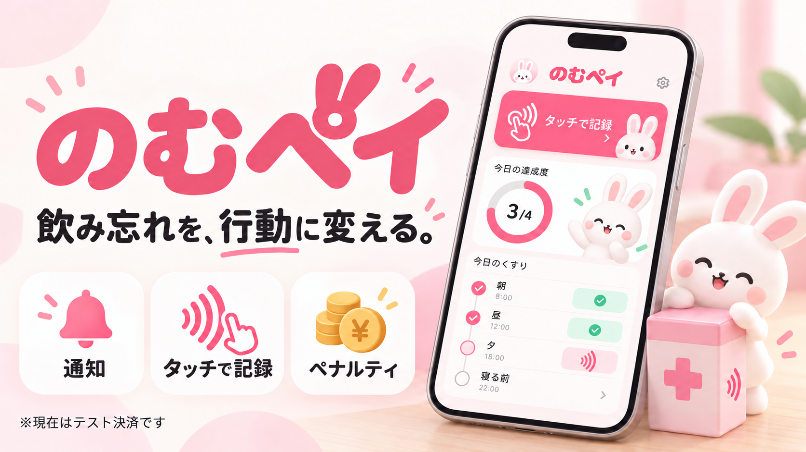

# のむペイ

**「あとで飲もう」を、「今、飲もう」に。**

通知を見ても薬を後回しにしてしまう人へ。のむペイは、薬箱での読み取りと期限・ペナルティを組み合わせた服薬習慣化アプリです。

[](https://www.youtube.com/watch?v=piaNsc6ilBI)

## 想定ユーザー（ペルソナ）

**「飲み忘れてはいけない」と分かっていても、つい忘れてしまう人。**
月経に関する治療や避妊のためにピルを服用している人、高血圧・糖尿病などの治療で継続的な服薬が必要な人を想定しています。

仕事・家事・外出で生活リズムが変わり、通知を見ても「あとで飲もう」と後回しにしてしまう。そんな人が、医師・薬剤師の指示に沿った服薬を日常の習慣にできるよう、薬箱での記録とリマインダーで後押しします。

**この層への強い訴求力が期待できます。** 「飲み忘れを防ぎたいのに、通知だけでは続かない」という切実な悩みに対し、薬箱へ向かう行動と自分で設定するペナルティを組み合わせ、「今、飲もう」と思える具体的なきっかけを提供します。

## できること

- **薬と薬箱をまとめて管理**：服用時刻・期間・服用量・前後の猶予時間を設定。
- **薬箱で服用を記録**：AndroidはNFCタグ、iOSは端末共通QRを読み取り。同じ薬箱・同じ予定日時の薬は、受付時間内ならまとめて記録できます。
- **通知で行動を後押し**：服用10分前・ペナルティ予定10分前・テスト決済完了をお知らせ。
- **飲み忘れを可視化**：期限内に記録がない予定には設定額のペナルティを記録。服薬状況と結果をカレンダーで振り返れます。

現在の決済は端末内のシミュレーションです。実際の請求や決済サービスへの通信は行いません。

## ビジネス展開：持ち歩ける「のむペイ」


*製品展開のコンセプト画像です。販売仕様・画面デザインは検討中です。*

**NFC内蔵ポーチを、毎日の服薬の入り口に。**
自宅用のスマート薬箱に加え、外出先でもスマートフォンをかざして服用を記録できるNFC内蔵ポーチの販売を構想しています。アプリと日常使いの収納用品を組み合わせ、ポーチ・薬箱の物販を収益源にします。現在のNFC対応はAndroidです。

**ローカル動作で運用コストを抑え、物販利益につなげる。**
服薬データは端末内のSQLiteに保存し、通知も端末内で処理します。現在の主要機能は外部Web APIや常設バックエンドに依存せず、利用者増に伴うサーバー費・API従量料金を抑えられる構成です。製造・販売・保守費を管理しながら、商品販売による利益を目指します。


## 起動方法

このリポジトリ直下で実行してください。Node.jsは24.3以上の24系を使用します。以下の `*:node24` コマンドはNode.js 24経由で実行します。

### 初回：開発用アプリを実機に入れる

AndroidはAndroid Studio・SDK・JDKとUSBデバッグ、iOSはMac・Xcode・CocoaPodsと署名設定が必要です。

```bash
npm run setup

# 使用するOSのどちらかを実行
npm run android:node24
npm run ios:node24
```

iOSで署名を求められた場合は、生成された `ios/*.xcworkspace` をXcodeで開き、Signing & Capabilitiesで自分のTeamを選択します。Expo Goではなく、このアプリ専用のDevelopment Buildを使用してください。

### 2回目以降

```bash
npm run start:node24
```

PCと端末を同じLANに接続し、端末の開発用アプリでサーバーを開きます。ネイティブ依存・権限の変更後は、OS別のビルドコマンドで再ビルドしてください。

### Android：PCなしで動くAPKを作る

```bash
npm run apk:credentials  # 初回のみ。既存の署名鍵があれば再利用
npm run apk:build
```

生成された `dist/nomupay-android.apk` を端末にインストールすると、アイコンから単独起動できます。署名鍵・`credentials.json` はGitに入れず保管し、更新時も同じ鍵を使用してください。

## デモの流れ

1. 初回起動で薬箱とダミーカードを登録し、「お薬」から薬を追加。
2. Androidは薬箱のNFCタグ、iOSは「薬箱」の共通QRを印刷または別端末に表示して読み取り。
3. 「設定」からデモ通知・ペナルティ発生画面を体験。

## 技術構成・確認

Expo / React Native / TypeScript / Expo Router / SQLite。NFC・カメラ・ローカル通知を利用しています。

```bash
npm run typecheck
npm run lint
npm test
```
