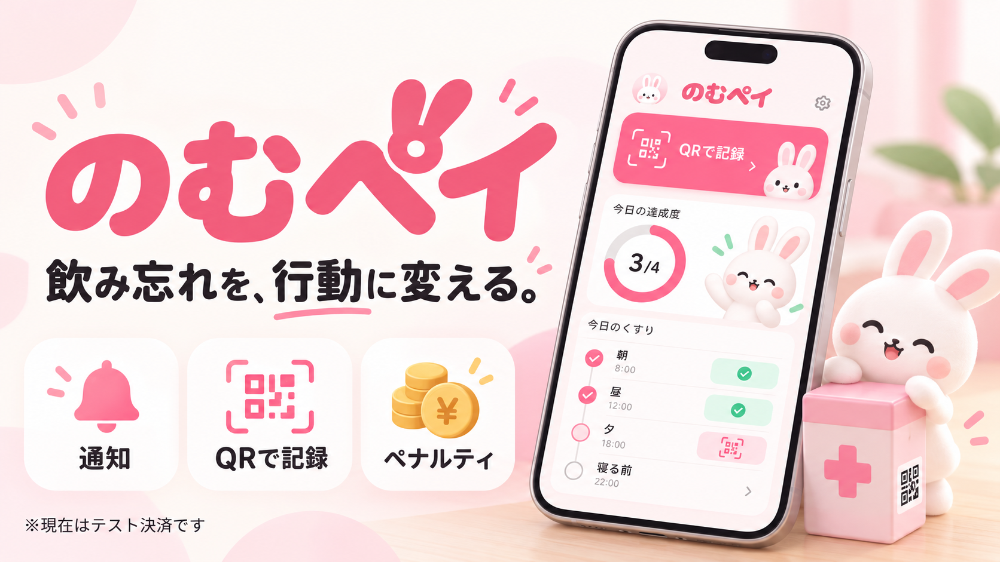
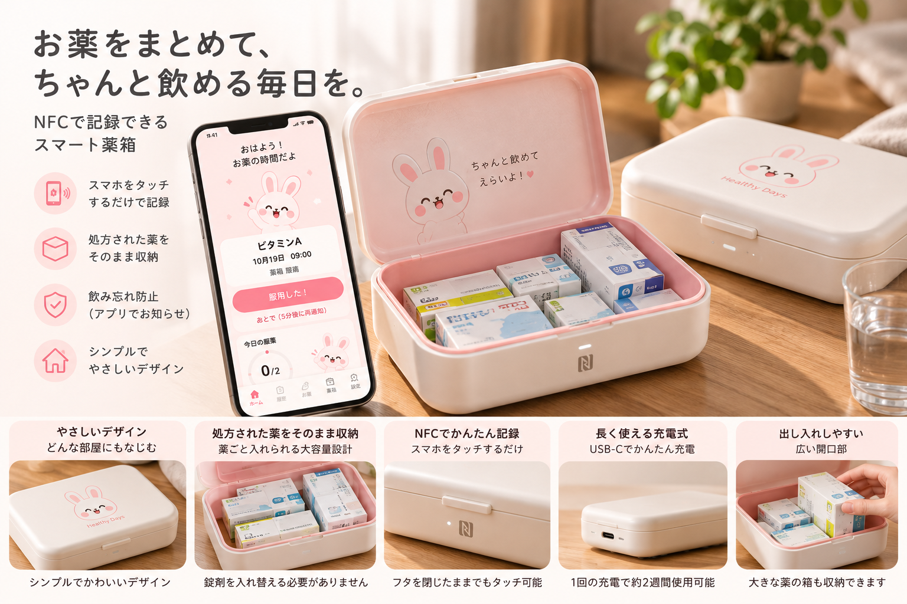

# のむペイ

**「飲み忘れると、実際にお金がかかる。」その強制力で、毎日の服薬を後押しする。**

のむペイは、猶予時間内に服用の記録がなければ実際に課金する仕組みを中心に据えた、iOS／Android向け服薬支援アプリです。本リポジトリでは、その体験を疑似決済で再現したデモを実装しています。



> [!IMPORTANT]
> このアプリはハッカソン向けのローカルデモです。実際の決済、請求、送金、クレジットカード連携は行いません。登録するカードも固定の架空データです。

## コンセプト

のむペイの核は、**飲み忘れ時の実課金によって、服薬に金銭的な強制力を持たせること**です。「あとで飲もう」と後回しにした結果に金銭的な負担が伴うことで、期限内に服薬する動機を作り、飲み忘れの防止を目指します。利用者が課金条件に同意して使う、自分の服薬習慣のための仕組みです。

本番では服用予定・猶予時間・課金額を設定し、期限内に記録すれば課金されず、記録がなければ実際に課金されます。通知は行動のきっかけを知らせ、QR／NFCは薬箱での記録を支え、履歴は結果を見えるようにします。

読み取りは利用者による服用記録の操作です。薬を実際に飲んだことをセンサーで検出する仕組みではありません。

## ドキュメント案内

- アプリを体験する：[デモの流れ](#デモの流れ)
- 動作を理解する：[服薬判定とペナルティ](#服薬判定とペナルティ)、[通知](#通知)
- 開発する：[開発環境の準備](#開発環境の準備)、[品質確認](#品質確認)
- 事業構想を読む：[ビジネス展開の詳細](./docs/business-plan.md)

## 想定ユーザー（ペルソナ）

**「飲み忘れてはいけない」と分かっていても、つい忘れてしまう人。**
月経に関する治療や避妊のためにピルを服用している人、高血圧・糖尿病などの治療で継続的な服薬が必要な人を想定しています。

通知を見ても「あとで飲もう」と後回しにしてしまう人を、薬箱での記録とリマインダーで後押しします。

通知だけでは続かない悩みに対し、本番では「記録しなければ実際に課金される」という条件を設け、「今、飲もう」と行動する動機を作ります。飲み忘れの減少や継続率への効果、利用者の負担は、今後の検証で確認します。

## ビジネス展開：実課金で服薬習慣を支える

本番サービスでは、実決済を組み込んだ服薬支援を中心に展開します。期限判定、課金、結果通知までを一つのサービスとして提供し、アプリを閉じていても課金条件を適切に判定できる仕組みを整備します。薬箱やNFC内蔵ポーチは、この課金システムと日常の服薬記録をつなぐ商品です。



画像は商品構想のイメージです。画像内の充電方式・電池持ち・筐体仕様・画面は製品仕様として確定していません。現在のアプリはAndroidでNFC、iOSでQRに対応しています。

**NFC内蔵ポーチを、毎日の服薬の入り口に。**
自宅用のスマート薬箱に加え、外出先でもスマートフォンをかざして服用を記録できるNFC内蔵ポーチの販売を構想しています。ポーチ・薬箱の物販を収益源にします。現在のNFC対応はAndroidです。

現在のデモは端末内で完結しますが、本番ではサーバー側の期限判定と決済連携を整備します。課金額の帰属・配分やサービス利用料は未確定です。事業計画では決済・サーバー運用・問い合わせ対応の費用も含めて検討します。課金システムの本番化、収益設計、薬箱・ポーチの展開は[ビジネス展開の詳細](./docs/business-plan.md)をご覧ください。

### 現在のデモと本番構想

| 項目 | 現在のデモ | 本番構想 |
| --- | --- | --- |
| 期限経過時 | 疑似ペナルティを端末内に記録 | 同意した条件に基づく実際の課金 |
| 支払手段 | 固定の架空カード | 決済サービスを介して登録する支払手段 |
| 判定 | アプリ起動・復帰時および表示中 | サーバー側で期限と服用記録を判定 |
| 薬箱・ポーチ | QR／NFCによる記録体験を検証 | 課金システムと日常の服薬をつなぐ商品 |

## 現在のデモの主な機能

- 薬、服用時刻、曜日、服用前後の猶予時間を登録
- iOSはアプリ内QRコード、AndroidはNFCタグで服薬を確認
- 同じ薬箱・服用日・服用時刻の薬を一度に記録
- 服用前、服用時刻、ペナルティ直前、ペナルティ確定時にローカル通知
- 月ごとの服薬履歴と疑似ペナルティ合計を表示
- 端末内だけで動作し、アカウント登録や外部サーバーは不要

### 画面の役割

| フッター | できること | 主な実装 |
| --- | --- | --- |
| ホーム | 次の服用予定、残り時間、服用記録への導線を確認 | `src/app/index.tsx` |
| 履歴 | 月ごとの記録を振り返る | `src/app/history.tsx` |
| お薬 | 薬と服用予定を登録・編集・削除 | `src/app/medications/` |
| 薬箱 | 自宅用・持ち歩き用などの薬箱を登録、確認用タグやQRを管理 | `src/app/boxes/` |
| 設定 | 通知、ダミーカード、疑似ペナルティ履歴などを確認 | `src/app/explore.tsx` |

薬の削除時には確認ポップアップを表示します。ホームの残り時間は、服用時刻前には服用時刻まで、服用時刻後には疑似ペナルティの期限までを示します。

## プラットフォームごとの違い

| 項目 | iOS | Android |
| --- | --- | --- |
| 服薬確認 | QRコード | NFCタグ |
| 初回登録 | 薬箱名 → ダミーカード | 薬箱名 → NFCタグ → ダミーカード |
| カメラ | QR読み取りに使用 | 使用しない |
| NFC | 使用しない | タグIDの読み取りに使用 |

### iOSのQR確認

初回登録後にアプリが端末内でQRトークンを生成し、SQLiteへ保存します。服薬確認画面では、そのインストール環境で生成した有効なQRコードだけを受け付けます。QRコードは印刷したり別の端末へ表示したりして読み取れますが、別のインストール環境で生成したQRコードや、再生成前の古いQRコードは受け付けません。

### AndroidのNFC確認

AndroidではNFCタグのIDを使って薬箱を識別します。読み取るのはAndroid APIの `Tag.getId()` 相当の値だけです。

- NDEFメッセージは読み取りません
- クレジットカード番号、有効期限、名義、セキュリティコードなどは取得しません
- 実際の決済処理やカード認証は行いません

初回登録時に読み取ったタグIDと、服薬確認時に読み取ったタグIDが一致した場合に記録します。

## デモの流れ

1. 初回画面で薬箱の名前を入力します。
2. Androidのみ、薬箱に使うNFCタグを登録します。
3. 用意された架空カードから1枚を選び、任意のニックネームを付けます。
4. ホーム画面で薬、服用曜日、時刻、猶予時間、疑似ペナルティ額を登録します。
5. 服用時にiOSではQR、AndroidではNFCを読み取ります。
6. 記録結果をカレンダーや履歴画面で確認します。

カード登録画面に実在するカード番号を入力する欄はありません。保存されるのは、固定カードのプリセットID、ニックネーム、更新日時だけです。

### 動作確認のシナリオ

実際の服薬予定とは別のデモ用データで確認してください。AndroidのNFC読み取りには対応実機とタグ、iOSのQR読み取りにはカメラで読み取れる位置に印刷・表示したQRが必要です。

| 確認対象 | 操作 | 確認する結果 |
| --- | --- | --- |
| 正常な服用記録 | 未来の服用時刻を登録し、受付時間内にQR／NFCを読み取る | 服用完了と履歴への反映 |
| まとめて記録 | 同じ薬箱・曜日・時刻の薬を複数登録して読み取る | 各薬の受付時間内の予定がまとめて記録される |
| 期限経過 | 未来の服用時刻と服用後5分の猶予を設定し、記録せず期限を待つ | アプリ内のお知らせと疑似ペナルティ履歴への反映 |
| アプリ復帰 | 未記録のままアプリを閉じ、期限後に再度開く | 起動・復帰時の判定結果が反映される |
| 削除の取消 | 薬の削除操作で確認ポップアップをキャンセルする | 薬が残る |

登録前に過ぎた服用予定は疑似ペナルティの対象にならないため、期限経過の確認では必ず未来の服用時刻を設定します。

## 服薬判定とペナルティ

薬ごとに次の猶予時間を設定できます。

- 服用前: 0〜60分
- 服用後: 5〜60分
- 設定単位: 5分
- 初期値: 服用前0分、服用後30分

確認時刻が猶予時間内なら服薬成功です。同じ薬箱・服用日・服用時刻に属する薬は、それぞれの猶予時間内であればまとめて記録されます。

猶予時間を過ぎた予定には、設定した金額の疑似ペナルティが記録されます。これは端末内だけのシミュレーションであり、実際の決済は発生しません。

ペナルティの判定は、アプリの起動時、フォアグラウンド復帰時、およびアプリ表示中の定期処理で行われます。アプリを完全に終了している間にサーバーやバックグラウンド処理が課金する仕組みではありません。終了中に期限を過ぎた予定は、次にアプリを開いたときにまとめて反映されます。

## 通知

ローカル通知は、登録内容に応じて次のタイミングで予約されます。

- 服用時刻の10分前
- 服用時刻
- ペナルティ確定の10分前
- ペナルティ確定後

予定通知は最大60件、現在から7日先までを対象に予約します。薬や設定の変更時、アプリ起動時、フォアグラウンド復帰時に予約内容を更新します。

OSへ予約済みのローカル通知は、通常はアプリをタスク一覧から終了しても届きます。ただし、次の場合は届かない、または遅れることがあります。

- Androidで「強制停止」した場合
- 通知権限が無効な場合
- Androidの正確なアラームが許可されていない場合
- 端末メーカー独自の省電力設定で制限された場合

ペナルティ確定後の通知は、アプリがペナルティを判定した時点で作成されます。そのため、アプリを完全に終了していた場合は次回起動時の反映・通知になります。

## データ保存とプライバシー

データは端末内のSQLiteデータベース `nomupay.db` に保存されます。現在のDBスキーマバージョンは9です。

このデモにはアカウント登録、クラウド同期、バックアップ、アプリ内の全データ初期化ボタンはありません。完全に初期状態へ戻す場合は、アプリを端末から削除して再インストールしてください。Expo Goで開いている場合は、Expo Go自体のアプリデータ削除または再インストールが必要になることがあります。この操作ではExpo Go内の他のプロジェクトデータにも影響するため注意してください。

## 技術構成

- Expo SDK 57
- React Native 0.86
- React 19
- Expo Router
- TypeScript
- SQLite
- Node.js 24
- Android SDK Platform 36
- JDK 17
- Xcode 26.4（iOSビルド時）

## 開発環境の準備

### 共通要件

- Git
- Node.js 24
- npm

Node.js 24を利用できる状態で、次のコマンドを実行します。プロジェクト内の `node24` ラッパーは、以降のコマンドをNode.js 24で実行するために使います。

```bash
git clone https://github.com/jphacks/ok_2605.git
cd ok_2605
npm run setup
```

`npm run setup` は、ロックファイルに従って依存関係をインストールします。以降のコマンドは、リポジトリのルートディレクトリで実行してください。

### iOS

必要なもの:

- macOS
- Xcode 26.4
- iOS Simulator、または開発者モードを有効にした実機

初回、またはネイティブ設定を変更した後:

```bash
npm run node24 -- npx expo run:ios
```

開発ビルドを端末やSimulatorへインストール済みの場合:

```bash
npm run start:node24
```

### Android

必要なもの:

- Android Studio
- Android SDK Platform 36
- JDK 17
- Android Emulator、またはUSBデバッグを有効にした実機

初回、またはネイティブ設定を変更した後:

```bash
npm run node24 -- npx expo run:android
```

開発ビルドを端末やEmulatorへインストール済みの場合:

```bash
npm run start:node24
```

カスタムネイティブ設定を使っているため、Expo Goだけではすべての機能を再現できません。QR、NFC、通知を含めて確認する場合は、開発ビルドまたは配布ビルドを使用してください。

## Android APKについて

現在のリポジトリには、配布用の署名済みAPKを生成する固定コマンドや署名鍵は含めていません。APKを配布する場合は、組織のEAS Build設定または管理されたリリース手順を用意し、署名情報を安全な場所から渡してください。

ローカルで作成する署名鍵や成果物はGitへ追加しないでください。次のパターンは `.gitignore` の対象です。

- `.android-signing/`
- `credentials.json`
- `build/`
- `*.keystore`
- `*.p12`
- `*.apk`
- `*.aab`

署名鍵を紛失すると同じアプリIDの更新版を配布できなくなる場合があります。Gitリポジトリではなく、組織のシークレット管理サービスなどで保管してください。

## 品質確認

プロジェクトが要求するNode.js 24を確実に使うため、検証コマンドもラッパー経由で実行します。

```bash
npm run node24 -- npm run typecheck
npm run node24 -- npm run lint
npm run node24 -- npm test
```

## ディレクトリ構成

```text
src/
├── app/          # Expo Routerの画面とルート
├── components/   # 共通UI
├── features/     # 服薬、QR、NFC、通知、履歴などの機能
├── state/        # アプリ全体の状態管理
├── hooks/        # 共通フック
└── constants/    # テーマなどの共通定数
tests/            # 自動テスト
plugins/          # Expo config plugin
assets/           # 画像やフォント
docs/             # ビジネス展開の補足資料
```

画面は `src/app/`、判定や保存処理は `src/features/`、画面間で共有する状態は `src/state/` に置いています。服薬期限と疑似ペナルティの判定は `src/features/payments/penalty-repository.ts`、通知予定は `src/features/reminders/reminder-plan.ts` が主な確認先です。

## 困ったとき

| 症状 | 確認すること |
| --- | --- |
| iOSでQRを読み取れない | カメラ権限、同じインストール環境で発行したQRか、再生成前のQRでないかを確認 |
| AndroidでNFCを読み取れない | NFC対応実機か、端末のNFCが有効か、対象の薬箱にタグを登録済みかを確認 |
| 通知が届かない | 通知権限、登録した曜日・時刻、端末の省電力設定を確認し、アプリを開いて予約を更新 |
| 期限後のお知らせが表示されない | 服用済みでないか、服用後の猶予が終了したか、登録前の予定でないかを確認し、アプリへ復帰 |
| 別の端末で記録が見えない | データは端末内保存のため、端末間の共有・同期は未対応 |

## 現在の制約

- 実決済、カード会社連携、外部サーバーはありません
- データは端末間で同期されません
- AndroidのNFCタグIDは、タグや端末によって取得可否・表現が異なる場合があります
- 通知の正確な配信時刻はOSの権限や省電力設定に影響されます
- バックグラウンドでペナルティを確定するサーバー処理はありません

## 参考資料

- [Expo SDK 57](https://docs.expo.dev/versions/v57.0.0/)
- [Expo development builds](https://docs.expo.dev/develop/development-builds/introduction/)
- [Continuous Native Generation](https://docs.expo.dev/workflow/continuous-native-generation/)
- [Expo Notifications](https://docs.expo.dev/versions/latest/sdk/notifications/)
